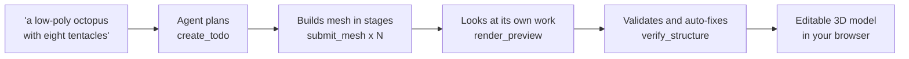
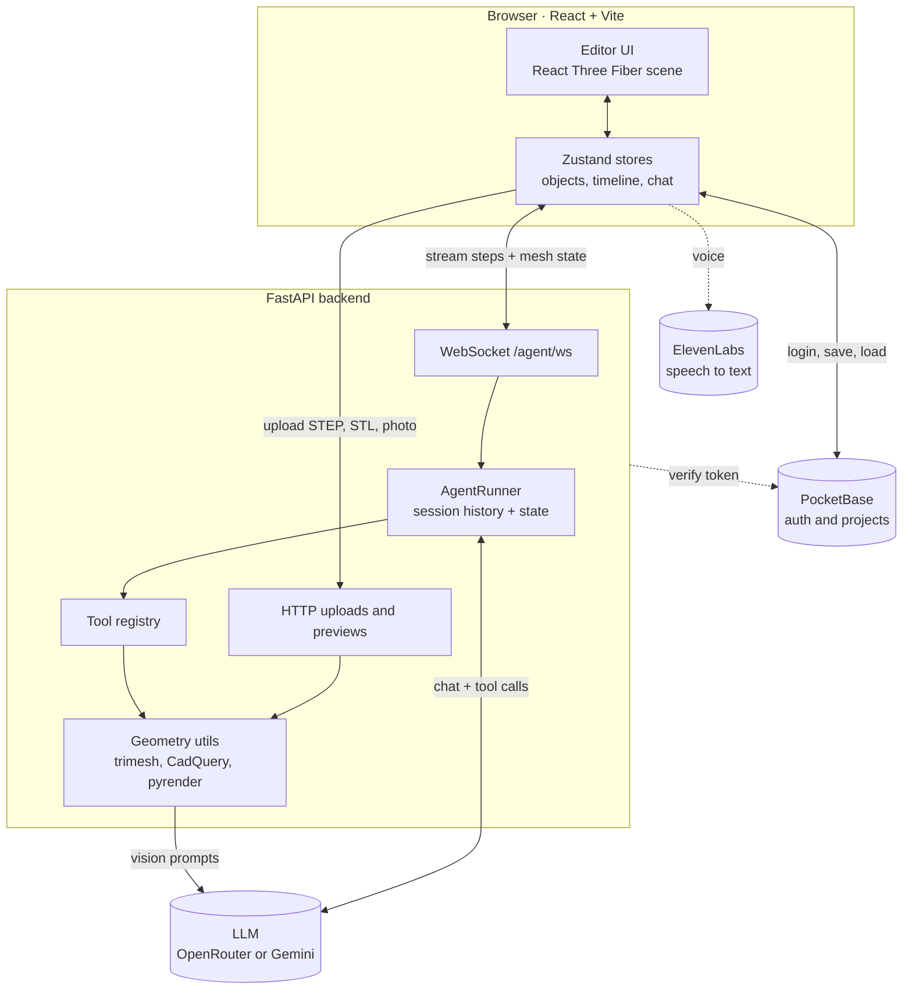
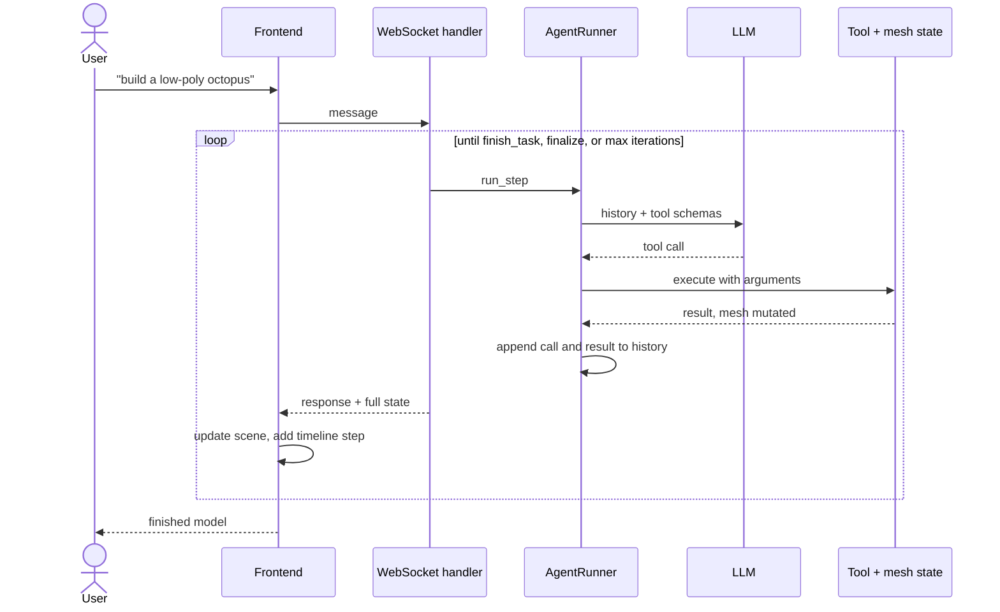
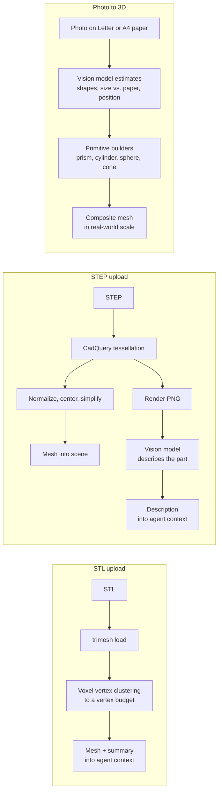

# subspace

**Describe an object in plain English and watch an AI agent build it as a low-poly 3D model.** Then orbit it, drag its vertices around, scrub back through every step the agent took, and download it as an OBJ.

subspace is a text-to-CAD workspace built around an LLM that doesn't just emit a blob of geometry. It works the way a modeller does: it plans, builds the mesh up in stages, looks at its own renders, runs validation, and fixes what it finds. You can also hand it existing geometry (STL, STEP, or a photo of a part on a sheet of paper) and ask it to describe, simplify, or modify it.



## What you can do

| | |
| --- | --- |
| **Generate from text** | The agent breaks the request into a todo list, then calls `submit_mesh` repeatedly, each call adding thickness, limbs, or detail on top of the last. |
| **Iterate in chat** | Ask for changes on an existing model ("make the tentacles longer", "add a base"). The agent keeps the full conversation and mesh state. |
| **Import STL** | Upload an STL. It is voxel-clustered down to a small vertex budget so the agent can reason about it, then you can ask what it is or edit it. |
| **Import STEP** | Upload a STEP file. It is tessellated with CadQuery, simplified, and also rendered and described by a vision model so the agent understands the part. |
| **Photo to 3D** | Photograph an object on Letter or A4 paper. A vision model uses the paper as a scale reference and estimates the object as primitives (prism, cylinder, sphere, cone) with real-world dimensions. |
| **Edit by hand** | Drag individual vertices in 3D, translate, rotate, and scale objects, change colours, and toggle units. |
| **Time travel** | Every agent step lands on a timeline. Scrub, undo, and redo through the build. |
| **Composite previews** | Drop your model into a background scene and generate a photoreal product render. |
| **Voice input** | Dictate prompts with ElevenLabs speech-to-text. |
| **Download and save** | Export the mesh as `.obj`. Accounts and a per-user project library are backed by PocketBase. |

## How it works

### System overview

The frontend talks to the FastAPI backend over a WebSocket for the live agent session and plain HTTP for uploads. Auth and saved projects live in PocketBase, and the backend never sees a password: it only verifies the PocketBase token.



### The agent loop

Each user message kicks off a loop. On every step the model either calls a tool or replies in text; the tool runs against shared mesh state, the result goes back into the conversation, and the full state is streamed to the browser so the 3D view updates live.



Because tools register themselves on import, adding a capability means writing one `Tool` subclass: a name, a JSON schema, and an `execute` method.

| Tool | What it does |
| --- | --- |
| `create_todo`, `task_done` | Plan the work and tick tasks off |
| `submit_mesh` | Create or update the mesh from named vertices, faces, optional edges, and lofting loops |
| `inspect_mesh` | Read back the current mesh so the agent can describe or modify it |
| `render_preview` | Render the mesh and feed the image back for visual feedback |
| `verify_mesh` | Structural validation |
| `verify_structure` | Integrity checks with auto-fix; `printability` and `completeness` modes add an LLM review |
| `photo_to_3d` | Build a starting model from a photo |
| `finalize`, `finish_task` | Stop the loop |

You can also run `/inspect-mesh`, `/verify`, `/render`, and `/finalize` directly from the chat box without a model round-trip.

### Meshes the model can actually write

Models are bad at raw triangle soup, so geometry is expressed with **named vertices**. Faces refer to vertex IDs, which keeps the output readable, diffable, and easy to extend across multiple `submit_mesh` calls. For organic shapes the agent can describe **loops** (named vertex rings) and `stitch` them together to loft a surface instead of hand-writing every face.

```jsonc
{
  "vertices": [
    { "id": "head_0", "p": [-0.5, -0.5,  0.5] },
    { "id": "head_1", "p": [ 0.5, -0.5,  0.5] },
    { "id": "head_2", "p": [ 0.5,  0.5,  0.5] },
    { "id": "head_3", "p": [-0.5,  0.5,  0.5] }
    // ...
  ],
  "faces": [["head_0", "head_1", "head_2", "head_3"] /* ... */],
  "loops": { "ring0": ["a", "b", "c", "d"], "ring1": ["e", "f", "g", "h"] },
  "stitch": [["ring0", "ring1"]]
}
```

Coordinates live in `[-2, 2]` with Y up, and the system prompt requires solid 3D volume rather than flat planes so results are printable.

### Importing existing geometry

Three pipelines turn outside input into something the agent can work with.



Voxel clustering snaps vertices to a grid sized to hit the target vertex count and merges each cell to its centroid, which keeps the silhouette while shrinking a dense scan down to something an LLM can hold in context.

### The editor

The scene is React Three Fiber, driven by a single Zustand store that owns the objects, their transforms, the chat, the WebSocket, and the timeline. Because every agent step is recorded, undo, redo, and scrubbing are just moves along that history. Projects are saved to PocketBase as one JSON snapshot and rehydrated on load.

## Tech stack

| Layer | Tools |
| --- | --- |
| Frontend | React 19, Vite, Tailwind CSS 4, React Three Fiber, drei, Zustand, GSAP, Framer Motion |
| Backend | FastAPI, Pydantic, trimesh, NumPy, Pillow, CadQuery (optional), pyrender (optional) |
| AI | OpenRouter or Gemini for the agent and vision tasks, Gemini image generation for composite previews |
| Auth and data | PocketBase |

## Getting started

Prerequisites: Python 3.11, Node.js 18+, and [PocketBase](https://pocketbase.io/docs/).

### 1. PocketBase

```bash
pocketbase serve
```

Open http://127.0.0.1:8090/_/, create an admin account, then create the collections described in [docs/pocketbase-schema.md](docs/pocketbase-schema.md) (a `tier` field on `users`, and a `projects` collection).

### 2. Backend

```bash
cd be
python3.11 -m venv venv && source venv/bin/activate
pip install -r requirements.txt
cp .env.example .env
uvicorn main:app --reload --port 8000
```

Set `LLM_PROVIDER` to `openrouter` or `gemini` in `be/.env` and add the matching API key. The backend will not start without one.

For STEP import and headless preview renders, also install the optional extras listed at the bottom of `be/requirements.txt` (`cadquery`, `pyrender`).

### 3. Frontend

```bash
cd fe
npm install
cp .env.example .env
npm run dev
```

Open http://localhost:5173, sign up, and open the editor.

## Configuration

| File | Variable | Purpose |
| --- | --- | --- |
| `be/.env` | `LLM_PROVIDER` | `openrouter` or `gemini` |
| `be/.env` | `OPENROUTER_API_KEY`, `OPENROUTER_MODEL` | OpenRouter credentials and model |
| `be/.env` | `GEMINI_API_KEY`, `GEMINI_MODEL` | Gemini credentials and model |
| `be/.env` | `POCKETBASE_URL` | Used to verify user tokens |
| `fe/.env` | `VITE_API_URL` | Backend URL, defaults to `http://localhost:8000` |
| `fe/.env` | `VITE_POCKETBASE_URL` | PocketBase URL, defaults to `http://127.0.0.1:8090` |
| `fe/.env` | `VITE_ELEVENLABS_API_KEY` | Optional voice input |

`VITE_` variables are bundled into the browser build, so only use a restricted ElevenLabs key. Never commit `.env` files.

The backend allows all CORS origins by default; restrict `allow_origins` in [be/main.py](be/main.py) before deploying.

## Project layout

```
subspace/
├── be/                   FastAPI backend
│   ├── ai/               LLM clients and the agent loop
│   ├── tools/            Agent tools, one class each
│   ├── services/         STEP analysis, photo to 3D, preview generation
│   ├── utils/            Mesh simplification, rendering, STEP/STL conversion
│   ├── routers/          HTTP and WebSocket endpoints
│   ├── prompt/           System prompts
│   └── tests/
├── fe/                   React frontend
│   └── src/
│       ├── scene/        Three.js scene
│       ├── components/   Editor UI, timeline, chat, transform controls
│       ├── state/        Zustand stores
│       └── services/     Backend and PocketBase clients
├── docs/                 PocketBase schema
└── sample_models/        A bracket and a square in STEP and Fusion 360 formats
```

## Contributing

Issues and pull requests are welcome.

```bash
cd be && pytest tests
cd fe && npm run lint && npm run build
```

## License

[MIT](LICENSE)
